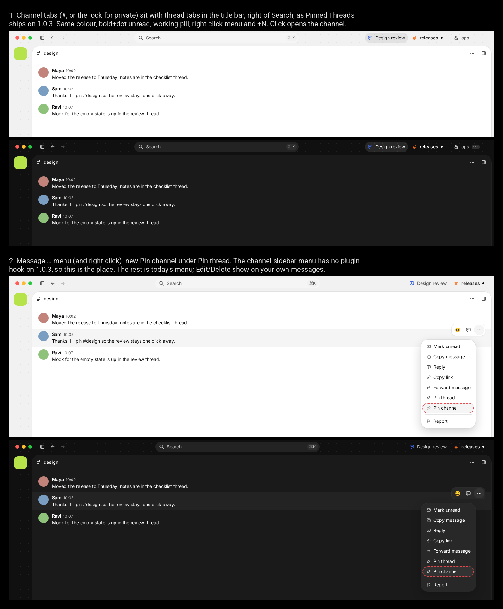
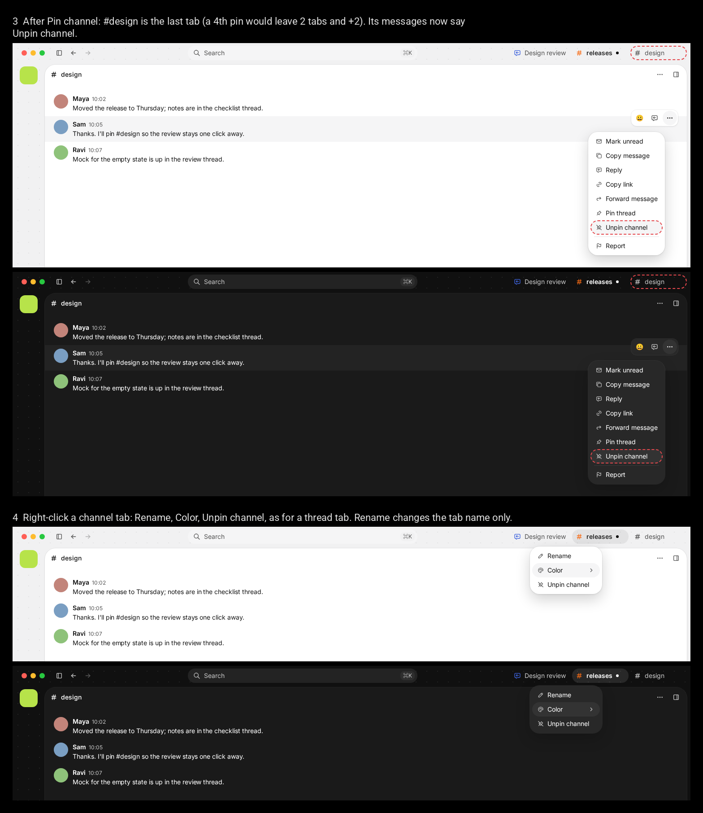

# Pinned Threads

Keep threads and channels one click away. Right-click a thread tab and
choose **Pin thread**. The thread then shows as a tab on its own row, below
the title bar and above the window, on every page. Click a pinned tab to
open its thread, even when it's in another channel or the sidebar is
collapsed.

To pin a whole channel, open the **…** or right-click menu on any message in
it and choose **Pin channel**. The channel shows as a tab next to the pinned
threads, with `#` (or a lock for a private channel) in place of the thread
icon, and a click opens the channel. A channel with no messages yet can't be
pinned, because Buzz has no plugin item in a channel's sidebar menu. DMs and
Solo chats don't offer Pin channel.

- A pinned tab shows unread the way the sidebar does: a bold title, plus a
  dot for mentions and replies. Three dots mean an agent is working in the
  thread, or anywhere in a pinned channel.
- Right-click a pinned tab (or press Shift+F10) to **Rename** it in place
  (Enter saves, Esc cancels, an empty name goes back to the thread's title),
  pick a **Color** for its icon (None plus 8 colours), or **Unpin** it.
- Tabs shrink to 9rem wide. After that, a **+N** button lists the rest.
- With nothing pinned, the row is hidden. A thread that's already pinned
  shows **Unpin thread** in its tab menu instead, and a pinned channel's
  messages show **Unpin channel**.
- New pins go at the end of the row. Renaming a channel tab changes the tab
  only, not the channel.

Pins are kept in this Mac's local storage for each community and account.
Only the current community's pins are shown.

## Requirements

The layout above needs a Buzz with two plugin extension points: `titleBarRow`
on panels, for the row, and `conversation.registerThreadTabAction`, for Pin
thread.

On a Buzz without them, the plugin uses places every Buzz has:

- The pinned tabs sit in the title bar, right of Search. They take at most
  half the window less 16rem, so Search narrows but keeps room, and the rest
  go under **+N**. Marks, the right-click menu and +N work the same.
- **Pin thread** is in a message's **…** and right-click menus. It pins the
  thread the message is in, or the thread it starts. A pinned thread's
  messages show **Unpin thread** there instead.

Pins are the same either way, so they stay put when Buzz gains the row.

## Install

**[Install in Buzz](https://man15h.github.io/buzz-plugins/install.html?path=plugins/pinned-threads)**. Buzz opens **Settings → Plugins → Add**
with this folder picked from Git.

If the link doesn't open Buzz, run the install link yourself:

```sh
open 'buzz://plugin-install?repository=man15h%2Fbuzz-plugins&path=plugins%2Fpinned-threads'
```

It asks for no access. Or install from a clone: **Settings → Plugins → Manage
plugins → Add**, then **Browse** under Add from folder, and pick the clone's
`plugins/pinned-threads/` folder.

## Mockups

Design sheets, in [`mockups/`](mockups/).





